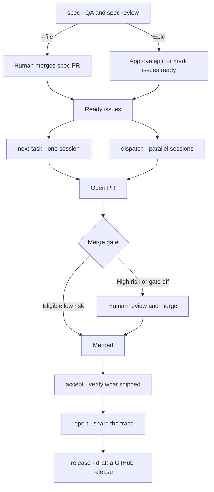

# devflow

A Claude Code plugin (version 3.2.3, see [CHANGELOG.md](CHANGELOG.md)) that takes GitHub work from idea to release.

## What it does

- Turn an idea into a spec and testable GitHub issues.
- Take ready issues through tests and review to pull requests.
- Check what shipped, trace the work, and draft release notes.

## Daily flow



After a merge, run accept, report, or release as needed.

## Commands

| Command | What it does |
| --- | --- |
| `/devflow:init` | Set up a project and optionally install GitHub workflows. |
| `/devflow:spec` | Create an epic and tasks, or use `--file` for a spec PR. Both modes extract shared groundwork into foundation tasks, record dependencies only on code or files a task uses, and warn when a task has 3 or more dependents. |
| `/devflow:approve` | Approve an epic so eligible tasks can become ready. |
| `/devflow:autopilot #<epic>` | Run an approved epic in a self-paced loop until all its sub-issues close. |
| `/devflow:next-task` | Test, implement, review, and open PRs for ready issues. |
| `/devflow:dispatch` | Run independent lanes in separate worktrees. Use `/devflow:dispatch --plan` to preview. |
| `/devflow:sync` | Update PR branches, retarget stacked PRs, and address review threads. |
| `/devflow:answer` | Record answers under `## Decisions` and set a blocked issue ready again. |
| `/devflow:accept` | Check merged work against its criteria. Use `/devflow:accept #<n>` for an epic. |
| `/devflow:report` | Publish a trace with metrics. Use `/devflow:report #<n>` for an epic. Use `--daily [#epic]` to print a daily digest for one epic or every open approved epic. |
| `/devflow:doctor` | Check setup, stale claims, and merged branches. Use `--fix` for confirmed repairs. |
| `/devflow:release` | Draft a GitHub release from a spec, everything since a tag, or all merged work. |

Eligible `risk:low` issues take a short path with a failing test first, then checks and review. The issue supplies its own criteria and decisions. For shared context, devflow reads the spec path first, then the epic named by `Epic: #<n>` if there is no path.

With `/devflow:dispatch`, linear dependency links share a lane. Hub children (several children of one parent) and multi-parent children wait in `stacked` and start in parallel once their parents have open PRs with commits ahead of their base. Their work stacks on the parent branch, or on an integration commit when several parent PRs are open. Shared hotspots keep work in the same lane. For readiness, a `Depends on #n` dependency is satisfied when #n is closed, or is open, not `agent:blocked`, and has an open PR whose head is ahead of its base. This is separate from the merge gate's rule below.

After approval, run `/devflow:autopilot #<epic>` to sync PRs, apply collaborator answers and start eligible lanes. The epic's plan comment shows waiting reasons, stalled work and the remaining agent budget. Run the command again after an interruption to resume from that comment.

## Install

1. Connect GitHub MCP. Have Python 3.9+ and Node 18+ available. For browser verification, use Playwright MCP or Claude in Chrome.
2. Run these commands in Claude Code.

   ```
   /plugin marketplace add nhanle-agilityio/devflow
   /plugin install devflow@nhanle-devflow
   ```

## Set up a project

1. Run `/devflow:init` to create `.claude/devflow.json` and choose the optional review, merge gate, and mention workflows.
2. Put project conventions in `CLAUDE.md`. Init probes GitHub MCP and generates an allow list using the responding server's prefix. Background sessions need permissions in advance.
3. Run `/devflow:doctor` and check **Waiting on you** for the next action. Doctor also reports the **Automatically delete head branches** setting.
4. After a plugin update, run `/devflow:init --upgrade` to review template and config changes.

## How a run stays unblocked

| The run handles | You handle |
| --- | --- |
| Safe, reversible recommendations go into `## Decisions` on the issue and the PR gets `decisions:review`. | Type an answer only for blocked questions (see the block list below) and questions without a recommendation. Changes to contracts, risk or criteria are decided and flagged; you review and merge the `risk:high` PR. Use `/devflow:answer #<n> accept` to take all eligible recommendations. |
| It resumes matching branches (prefix `<type>/<issue>-`) and handles base conflicts in Integrate when the issue covers the behavior. | Resolve conflicts involving behavior outside the issue and approve changes to contracts or risk. |
| It pushes its feature branch and opens the PR. | Review and merge `risk:high` PRs and handle protected-branch changes. |

The Next column tells you what to do after each issue. The `devflow-claim` marker lets one run claim an issue at a time. The run can claim an unassigned issue or one assigned only to the authenticated user. See [run helpers](DESIGN.md#run-helpers) for `bin/devflow-run branch`, `bin/devflow-run check`, `bin/devflow-run restore`, and `bin/devflow-gh`.

## Configuration

| Key | What it controls |
| --- | --- |
| `github`, `baseBranch`, `checks` | Required settings for the repository, target branch, and local checks. A check's optional `lock` name makes lanes that share a local service (one database) run it one at a time. |
| `spec.autoReady`, `labels.epicApproved` | Ready eligible tasks on approved epics (`epic:approved`). Choose `off` (default), `low`, or `all`. |
| `review.github`, `mergeGate.requiredChecks` | Enable GitHub review and name the checks that must pass. Include `devflow/review` when GitHub review is on. |
| `nextTask.onQuestion`, `nextTask.trustDecisions` | Choose whether runs take safe recommendations and whether the gate can merge those PRs. |
| `nextTask.reviewModel`, `nextTask.maxAgentCalls` | Choose review models (Sonnet for low risk, Opus for high or unknown risk by default) and cap calls per issue. |
| `autopilot.maxLanes`, `autopilot.maxAgentCallsPerTick`, `autopilot.stallHours` | Limit `/devflow:autopilot`: lanes (falls back to `dispatch.maxLanes`, then 3), agent calls per tick (default 20) and hours without activity before work counts as stalled (default 12). |
| `branchPattern` | Name new work branches. |
| `verify.devServer` | Start the app for verification. Acceptance uses PR evidence when no dev server is configured. |
| `release.tagPrefix`, `changelog.fragmentsDir` | Set the tag prefix (default `v`) and optionally store one changelog fragment per issue. |

See the full [config schema](skills/init/templates/devflow.schema.json) and [starter config](skills/init/templates/devflow.json).

With the default question policy, `decide` takes the recommended option and records it under `## Decisions`. `decide-high` applies to a product decision, or a change to a criterion, contract or stored format, lowered risk, or a changed file matching `risk.highPaths`: the run still takes the recommendation, records it with `[needs human review]`, labels the PR `decisions:review` and forces `risk:high`, so a human merges it even with `nextTask.trustDecisions: true`. `block` applies to a question that is not reversible, skips a check, drops a must row, needs destructive git, is outside the repo or is malformed (or when `onQuestion` is `block`); secrets, credentials and permission problems also stop that task, and other lanes continue. A blocked question that changes a criterion still needs a typed answer in `/devflow:answer`. If checks stay red after the fix rounds, or output names a missing environment variable or secret, the run files one `needs-triage` bug from the bug template per run error (deduplicated by `<!-- devflow-run-error #n -->`), labels the issue `agent:blocked` and links the bug.

## Merge gate

- This optional GitHub Action merges at most one eligible `risk:low` PR per run. Start with `mergeGate.enabled` and `mergeGate.dryRun` both true, then review the summary before turning dry run off.
- Install the workflow on the default branch, add `DEVFLOW_GATE_TOKEN`, enable merge commits, and match workflow triggers to the required checks. Review and mention workflows use `CLAUDE_CODE_OAUTH_TOKEN`. [Gate details](DESIGN.md#risk-and-the-merge-gate)
- The gate merges a PR only when its linked issues' dependencies are closed and it is not stacked, so stacks merge bottom-up. It also needs a mergeable PR on the base branch, green required checks on the PR head, and clear review threads. An empty effective check list stops merges.
- Behind PRs queue for an update (`deferred: waits for its turn`). The gate holds `decisions:review` for a human unless `nextTask.trustDecisions` is true.
- The gate records `devflow-gate-merged` and clears `labels.inProgress`, `labels.review`, and `labels.blocked` from issues linked to its merges.

Post-merge mode readies eligible dependent issues after human merges of same-repository PRs and retargets stacked devflow PRs when the merged PR has the devflow label and an unprotected head branch. A repository gets this mode only after upgrading its caller with `/devflow:init --upgrade` to a release that includes it.

## Safety

- Claude never merges PRs. The guard blocks protected-branch pushes, destructive Git commands, and staging everything at once. [Guard rules](DESIGN.md#guard-hook-hooksguardpy)
- `/devflow:sync` trusts review input from OWNER, MEMBER, or COLLABORATOR. Other input is marked `ignored: not a collaborator`.
- `/devflow:answer` trusts replies from OWNER, MEMBER, or COLLABORATOR. Other replies are marked `ignored: not a collaborator`.
- The allow list includes read-only `Bash(gh issue view:*)` for issue context. Ship files out-of-scope follow-ups under `needs-triage` for a human to assess.

## Releasing devflow

- Follow the [release task template](CHANGELOG.md#release-process). This repo stores fragments in `changelog.d/` and assembles them with `bin/devflow-changelog`. The fragment directory never needs a lane.
- Load the candidate with `--plugin-dir`, create issues from the [low-risk](docs/smoke/low.md) and [high-risk](docs/smoke/high.md) fixtures, and run them in the sandbox as two lanes via `/devflow:dispatch`.
- Check both issues with the read-only smoke checker. Merge the release PR after both pass, then tag `vX.Y.Z`.

  ```bash
  node bin/devflow-smoke --repo nhanle-agilityio/devflow-sandbox --issue <n> --expect low   # or --expect high
  ```

[Design](DESIGN.md) · [Interactive flows](docs/devflow-flows.html) · [Changelog](CHANGELOG.md) · [MIT License](LICENSE)
